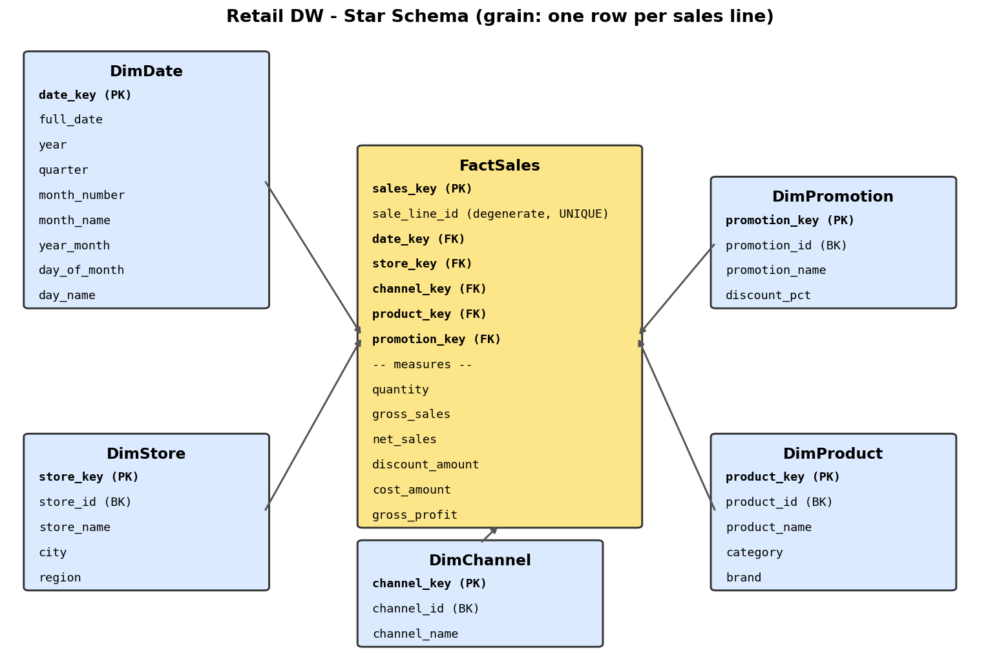
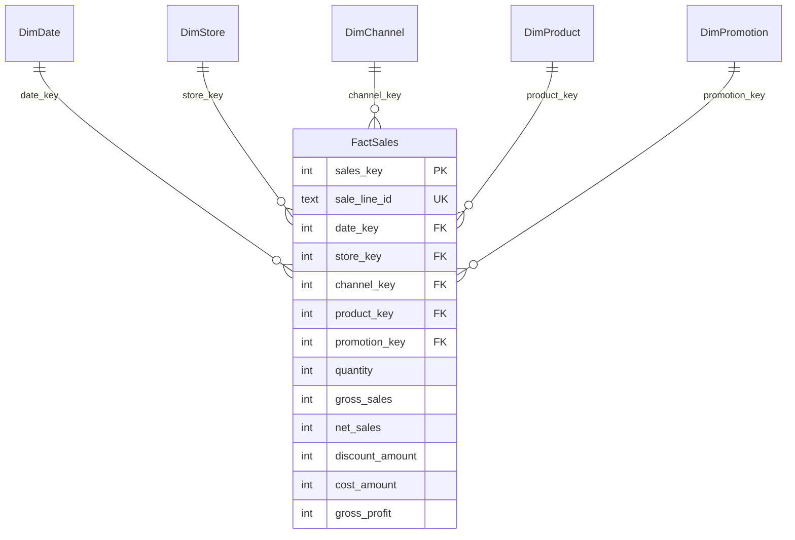
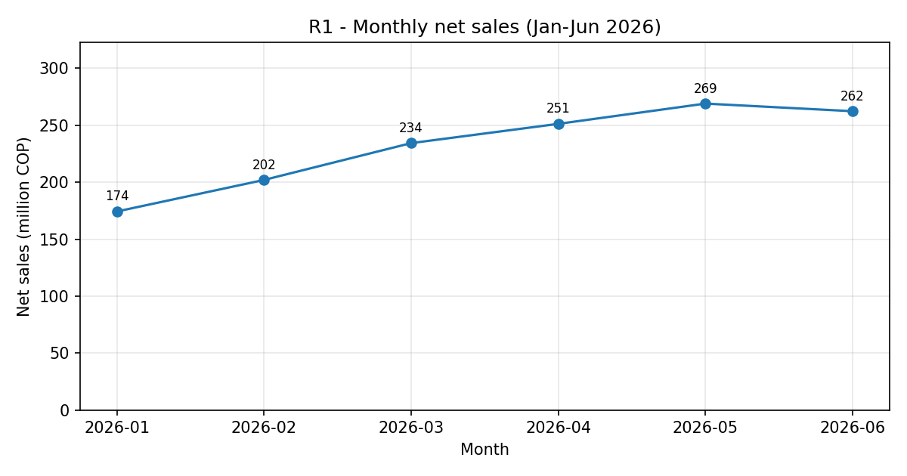
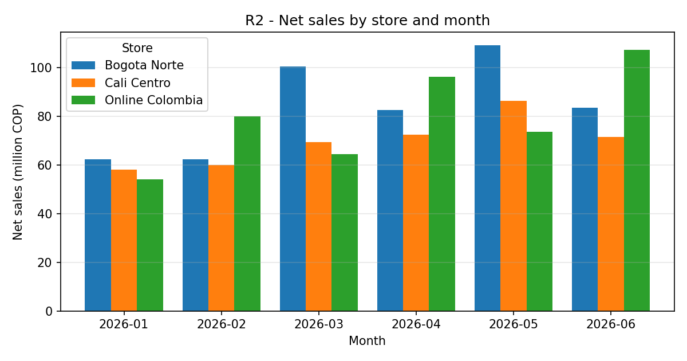

# Lab 2 – From Business Requirements to a Dimensional Data Warehouse

**Course:** ETL (G01) · Data Engineering and Artificial Intelligence · Universidad Autónoma de Occidente

## 1. Objective and business scenario
A retail technology company runs two physical stores (Cali Centro, Bogota Norte) and one national online store. Management wants six months of sales (Jan–Jun 2026, 1,000 sales lines) consolidated into a **SQLite star-schema Data Warehouse** that supports recurring analytical queries and future dashboards. The focus is dimensional design, not complex ETL.

## 2. Business requirements
| ID | Requirement |
|---|---|
| R1 | Monitor monthly net sales trends and identify periods of growth or decline. |
| R2 | Compare sales performance across stores and sales channels over time. |
| R3 | Identify top-performing product categories and brands using revenue and units sold. |
| R4 | Evaluate promotion performance by comparing sales, units, and discounts across promotion types. |
| R5 | Analyze gross profit and gross margin by product category, store, and month. |

### Requirements traceability (Part A)
| Req. | Analytical question | Required data | KPI / query |
|---|---|---|---|
| R1 | Is net sales growing or declining month to month? | Sale date (month), net sales | Monthly net sales + MoM growth % (`R1_monthly_net_sales`) |
| R2 | Which stores/channels sell more, and how does that change over time? | Store, channel, month, net sales, units | Net sales by store/channel, by month (`R2a/b/c`) |
| R3 | Which categories and brands drive revenue and volume? | Category, brand, net sales, quantity | Net sales & units by category/brand (`R3a/b/c`) |
| R4 | Do promotions add volume, and at what discount cost? | Promotion type, quantity, gross/net sales, discount amount | Sales, units, discount by promotion (`R4`) |
| R5 | Where is profitability highest/lowest? | Category, store, month, net sales, cost, gross profit | Gross profit and margin % by category/store/month (`R5a–d`) |

## 3. System architecture

| Block | Input | Responsibility | Output |
|---|---|---|---|
| Requirements | Management questions | Drive every model element | R1–R5 |
| Sources | Files | Provide raw facts and reference data | 1,000 lines + 4 collections |
| Load (`src/`) | Sources | Load dimensions, map keys, calculate measures | Populated DW |
| Dimensional model | Load output | Store facts at a fixed grain | Star schema |
| SQL/KPIs | DW | Answer R1–R5 | Result tables |
| Visualizations | Query results | Communicate trend and comparison | PNG charts |

## 4. Dimensional design (four steps)
1. **Business process:** retail sales.
2. **Grain:** *One row per sales line, i.e. one product sold on one sales transaction.*
3. **Dimensions:** Date, Store, Channel, Product, Promotion (each justified below).
4. **Facts:** quantity, gross sales, net sales, discount amount, cost amount, gross profit.





### Dimensions
| Dimension | Attributes | Justification |
|---|---|---|
| DimDate | full_date, year, quarter, month_number, month_name, year_month, day_of_month, day_name | R1, R2, R5 (monthly analysis) |
| DimStore | store_id (BK), store_name, city, region | R2, R5 |
| DimChannel | channel_id (BK), channel_name | R2 (channel comparison) |
| DimProduct | product_id (BK), product_name, category, brand | R3, R5 |
| DimPromotion | promotion_id (BK), promotion_name, discount_pct | R4 |

Not carried into the DW: `transaction_id` (unique per line in this dataset, so it adds no analysis for R1–R5), and `list_price`/`unit_cost` as product attributes (they are only used to compute measures during load).

### Measures (all additive, in COP)
| Measure | Calculation | Requirements |
|---|---|---|
| quantity | source `quantity` | R2, R3, R4 |
| gross_sales | quantity × list_price | R4 |
| net_sales | quantity × unit_price_sale | R1–R5 |
| discount_amount | gross_sales − net_sales | R4 |
| cost_amount | quantity × unit_cost | R5 |
| gross_profit | net_sales − cost_amount | R5 |

**Gross margin %** = `SUM(gross_profit) / SUM(net_sales) × 100` is computed at query time, not stored, because a percentage is non-additive (averaging row-level margins would give wrong results at any higher level).

### Keys
* Every dimension has an integer **surrogate PK** (`*_key`) and keeps the source id as a unique **business key**.
* `FactSales` has its own surrogate `sales_key` and five **FKs** to the dimensions (enforced with `PRAGMA foreign_keys = ON`).
* `sale_line_id` is a degenerate dimension with a `UNIQUE` constraint, which enforces the declared grain.

## 5. Load order and surrogate-key strategy
1. `create_schema.py` – drops/creates all tables.
2. `load_dimensions.py` – loads DimDate (from distinct `sale_date`), DimStore, DimChannel, DimProduct, DimPromotion; SQLite `INTEGER PRIMARY KEY` assigns surrogate keys, and a `{business_key: surrogate_key}` map is returned for each dimension.
3. `load_fact.py` – for each source line, looks up all five surrogate keys (a missing id raises an error), computes the measures, and inserts into `FactSales`. This happens only after all dimensions exist.
4. `main.py` – validates (row count = source lines, FK check, net sales reconciles with the CSV), runs the queries, and builds the charts.

## 6. Execution
```bash
pip install -r requirements.txt
python src/main.py          # builds database/retail_dw.db, prints all query results, writes docs/*.png
python src/draw_star_schema.py   # optional: regenerates docs/star_schema.png
```

## 7. SQL queries / KPIs (all in `src/queries.py`)
| Req. | Query names | Evidence |
|---|---|---|
| R1 | `R1_monthly_net_sales` | Net sales per month + MoM growth (window function `LAG`) |
| R2 | `R2a_sales_by_store_channel`, `R2b_sales_by_store_month`, `R2c_sales_by_channel_month` | Store and channel comparison over time |
| R3 | `R3a_…category`, `R3b_…brand`, `R3c_…category_brand` | Net sales and units |
| R4 | `R4_promotion_performance` | Sales, units, gross sales, discount amount per promotion |
| R5 | `R5a_…category`, `R5b_…store`, `R5c_…month`, `R5d_…category_store_month` | Gross profit and margin % |

Key results (COP):

| Month | Net sales | MoM |
|---|---|---|
| 2026-01 | 174,317,400 | – |
| 2026-02 | 202,010,000 | +15.9% |
| 2026-03 | 234,355,400 | +16.0% |
| 2026-04 | 251,270,000 | +7.2% |
| 2026-05 | 269,076,300 | +7.1% |
| 2026-06 | 262,383,300 | −2.5% |

| Category | Units | Net sales | Gross margin % |
|---|---|---|---|
| Computers | 222 | 605,683,600 | 16.06 |
| Mobile Devices | 340 | 459,504,900 | 21.69 |
| Accessories | 800 | 219,875,700 | 50.98 |
| Smart Home | 383 | 108,348,200 | 46.42 |

| Promotion | Lines | Units | Gross sales | Net sales | Discount amount |
|---|---|---|---|---|---|
| No Promotion | 608 | 1,048 | 923,000,000 | 922,274,800 | 725,200 |
| Seasonal 10% | 197 | 377 | 251,890,000 | 226,343,400 | 25,546,600 |
| Online 15% | 134 | 231 | 231,070,000 | 196,918,400 | 34,151,600 |
| Clearance 20% | 61 | 89 | 59,870,000 | 47,875,800 | 11,994,200 |

Net sales by store: Bogota Norte 500.5M, Online Colombia 475.5M, Cali Centro 417.4M. Gross margin by store: Cali Centro 27.6%, Bogota Norte 27.1%, Online 22.8%.

## 8. Visualizations
**Visualization 1 – R1 (temporal): line chart** of monthly net sales, the natural choice for a trend over time.



Net sales rose every month from January through May (+15–16% in Feb–Mar, ~+7% in Apr–May) and dipped slightly (−2.5%) in June, the only decline in the period.

**Visualization 2 – R2 (comparative): grouped bar chart** of net sales by store and month, which compares categories side by side across time.



Bogota Norte leads overall and peaks in March and May; the online store is more volatile, leading in Feb, Apr, and June, while Cali Centro is the smallest but steadiest.

Both charts are generated from queries against `retail_dw.db`, not from the raw files.

## 9. Data observations
* **287 of 1,000 lines were sold above list price**, giving a *negative* `discount_amount` (−2.95M COP in total), and 1 line has a negative gross profit. The lab defines discount as `gross − net`, so the model keeps this behavior and does not hide it. In practice it means `unit_price_sale` does not always equal `list_price × (1 − discount_pct)` (differences of up to ~62,000 COP per unit). This is worth raising with the business before using R4 discount figures for decisions; for example, "No Promotion" shows a small positive discount (725,200 COP) net of these price differences.
* Each store maps to exactly one channel in this data, so channel and store are correlated. Channel is still modeled as its own dimension because R2 asks for it explicitly and it is a sales-line attribute in the source.

## 10. Final reflection
**How did the requirements influence the model?** Each dimension exists because a requirement slices by it (Date → R1/R2/R5, Store/Channel → R2/R5, Product → R3/R5, Promotion → R4), and each measure exists because a KPI needs it (cost and gross profit only for R5, discount and gross sales only for R4). Source fields nobody asked about (`transaction_id`, list price and unit cost as attributes) were left out.

**Impact of an incorrect grain?** If the grain were, say, one row per day-store or per transaction, product-level questions (R3, R5 by category) could not be answered, and mixing grains would cause double counting or wrong totals. Too coarse a grain cannot be recovered later; too fine a grain without discipline leads to duplicated measures. Declaring one row per sales line, and enforcing it with `UNIQUE(sale_line_id)`, prevents both.

**Any unnecessary tables or attributes?** Not strictly. Two things are debatable: `DimChannel` is functionally dependent on `DimStore` in this dataset (each store has one channel), but it is kept as a separate dimension because R2 compares channels directly and the source records it on each sale line. Also, some `DimDate` attributes (`quarter`, `day_name`, `day_of_month`) are not needed by R1–R5; they are standard, low-cost calendar attributes that support the monthly analysis and future dashboards.
